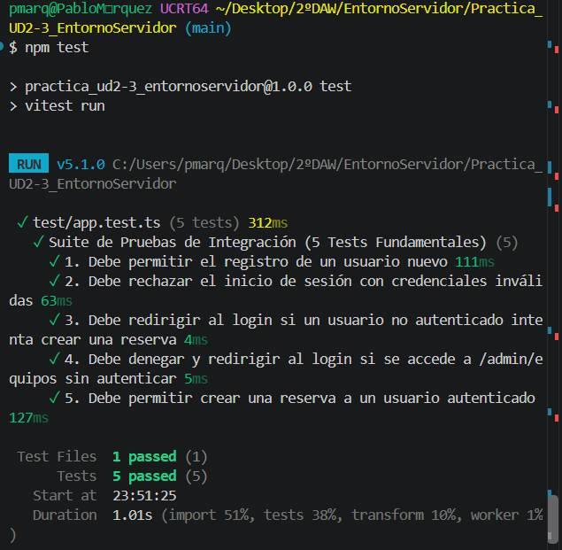

# Sistema de Reserva de Equipos Informáticos

Esta aplicación web modular está construida con Node.js, Express y TypeScript, aplicando una arquitectura limpia y bien estructurada (Dominio, Servicios, Repositorios en memoria y Controladores), con renderizado dinámico en servidor y seguridad por sesiones.

## Desglose Detallado de lo Realizado

### 1. Arquitectura por Capas (Clean Architecture)
* **Capa de Dominio (src/types/ y src/errors/)**:
  * Definición de interfaces y tipos core del sistema: **Usuario** (con roles **admin** y **usuario**), **Equipo** (tipos **portatil** y **sobremesa**, estados **operativo** y **mantenimiento**), **Reserva** y **Turno** (**manana** y **tarde**).
  * **ErrorDominio**: Clase personalizada extendida de **Error** para la captura y gestión centralizada de excepciones de negocio (ejemplo: credenciales inválidas, reservas duplicadas, accesos no autorizados).
* **Capa de Repositorios (src/repositories/)**:
  * **UsuarioRepositorio**: Gestión en memoria mediante mapas JS (**Map<number, Usuario>**), búsqueda por email e ID, y hashing de contraseñas.
  * **EquipoRepositorio**: Gestión de inventario con filtrado por tipo y estado, e implementación de borrado lógico (soft-delete) cambiando el estado a fuera de servicio sin destruir registros.
  * **ReservaRepositorio**: Persistencia de reservas, control de solapamientos por fecha/turno y consulta de historial por usuario.
* **Capa de Servicios (src/services/)**:
  * **UsuarioServicio**: Casos de uso de registro y autenticación con verificación de contraseña mediante **bcrypt**.
  * **EquipoServicio**: Casos de uso para consulta, filtrado de catálogo y administración de equipos.
  * **ReservaServicio**: Validaciones complejas de negocio (verificación de equipo disponible, comprobación de disponibilidad en fecha/turno y asignación del usuario en sesión).
* **Capa de Controladores (src/controllers/)**:
  * **authControlador**: Manejo de **GET /login**, **POST /login**, **GET /registro**, **POST /registro** y **POST /logout**. Implementación del patrón PRG (Post-Redirect-Get) enviando redirecciones **303** con mensajes flash en sesión.
  * **reservaControlador**: Gestión de la vista del catálogo, procesamiento de reservas activas y cancelación restringida por propietario.
  * **adminControlador**: Gestión del panel de administración y operaciones de mantenimiento sobre equipos.

### 2. Seguridad, Sesiones y Control de Acceso
* **Autenticación con bcrypt**: Encriptación de claves para asegurar que no se almacenen contraseñas en texto plano.
* **Persistencia de Sesión (express-session)**: Almacenamiento seguro del objeto de sesión en el servidor, vinculando las peticiones al **usuarioId** almacenado en la cookie de sesión.
* **Middlewares de Protección (src/middlewares/)**:
  * **requerirAutenticacion**: Intercepta rutas privadas (**/mis-reservas**, **/reservas**); si no hay sesión activa, redirige con **303** a **/login**.
  * **requerirRol('admin')**: Control de Acceso Basado en Roles (RBAC). Impide que usuarios estándar accedan a la zona de administración (**/admin/equipos**).
  * **loginLimiter (express-rate-limit)**: Limita las peticiones en **/login** (máximo 5 intentos por ventana de 15 minutos) para mitigar ataques de fuerza bruta.

### 3. Funciones Puras JS y Cookies de Preferencia
* **Funciones Auxiliares Puras (src/utils/helpers.ts)**:
  * **obtenerEquiposDisponibles**: Uso de **filter** para extraer solo equipos con estado **operativo**.
  * **estaReservado**: Uso de **some** para validar la ocupación de un equipo en una fecha y turno concretos.
  * **validarReserva**: Uso de **find** para comprobar la existencia y estado operativo del equipo.
* **Cookie de Preferencias (src/routes/equipoRutas.ts)**:
  * Captura del parámetro **?preferencia=portatil|sobremesa** e inyección de la cookie **preferencia_equipo** con duración de 30 días, flag **httpOnly: true** (protección contra XSS) y **sameSite: 'lax'**.
  * Recuperación automática de la preferencia mediante **cookie-parser** cuando el usuario navega sin parámetros en la URL.

### 4. Pruebas de Integración Automatizadas (test/app.test.ts)
Suite completa desarrollada con **Vitest** y **Supertest** (5/5 tests pasados en verde):
1. **Registro**: Alta exitosa de un usuario nuevo y redirección a **/login**.
2. **Autenticación errónea**: Rechazo de credenciales inválidas y redirección a **/login**.
3. **Bloqueo anónimo**: Redirección a **/login** al intentar enviar un **POST /reservas** sin sesión.
4. **Protección RBAC**: Bloqueo con **303** hacia **/login** al acceder a **/admin/equipos** sin rol de administrador.
5. **Flujo completo de Reserva**: Simulación de sesión con **supertest.agent**, inicio de sesión y creación exitosa de una reserva.




## Guía Completa de Instalación, Compilación y Ejecución
Al clonar el repositorio, es necesario instalar las dependencias, configurar las variables de entorno, compilar el código TypeScript a JavaScript y lanzar el servidor.

### 1. Clonar e Instalar Dependencias
```bash
git clone <URL_DEL_REPOSITORIO>
cd Practica_UD2-3_EntornoServidor
npm install
```

### 2. Configurar Variables de Entorno
Crea un archivo **.env** en la raíz del proyecto (basado en **.env.example**):
```env
PORT=3001
NODE_ENV=development
SESSION_SECRET=clave_secreta_para_desarrollo_super_segura
```

### 3. Compilar TypeScript
Antes de ejecutar la aplicación, debes traducir el código TS a JS en la carpeta **dist/**:
```bash
npx tsc
```

### 4. Ejecutar la Aplicación
```bash
npm start
```

Una vez iniciado, abre el navegador e ingresa a: **http://localhost:3001**

## Cuentas de Prueba Pre-cargadas (Seed Data)
Para probar los diferentes roles y funcionalidades en el navegador:
* **Administrador:** **admin@campus.es** / **admin123**
* **Usuario 1:** **usuario1@campus.es** / **user123**
* **Usuario 2:** **usuario2@campus.es** / **user123**

## Ejecución de Pruebas Automatizadas (Vitest)
Para verificar que toda la lógica de rutas, middleware y controladores pasa los 5 criterios fundamentales de integración:
```bash
npm test
```